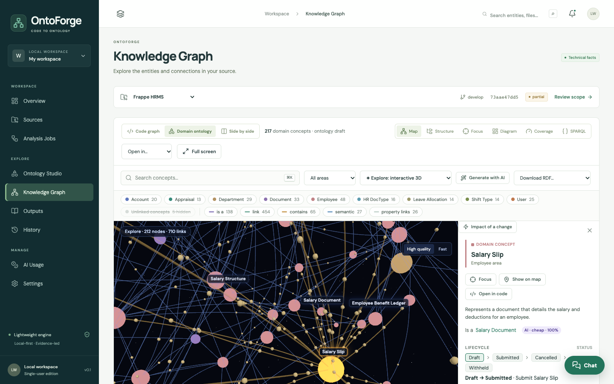
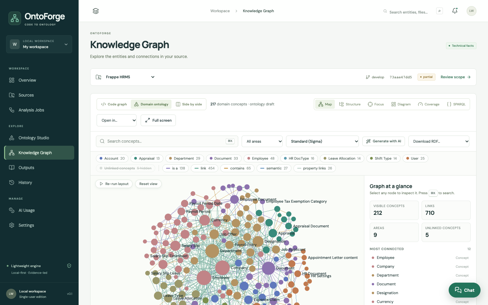
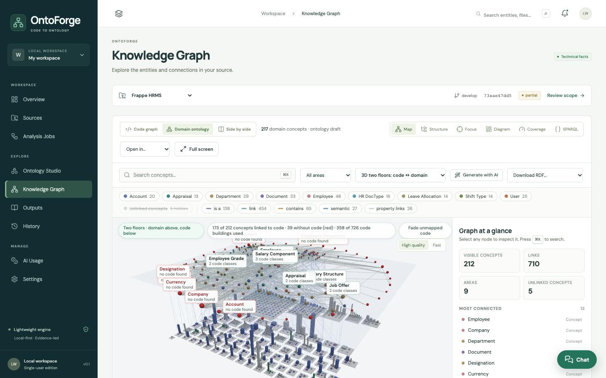
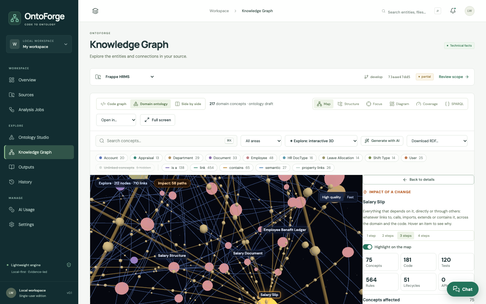
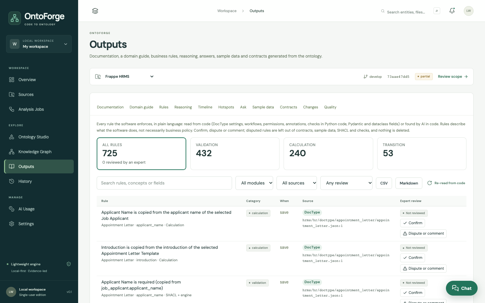
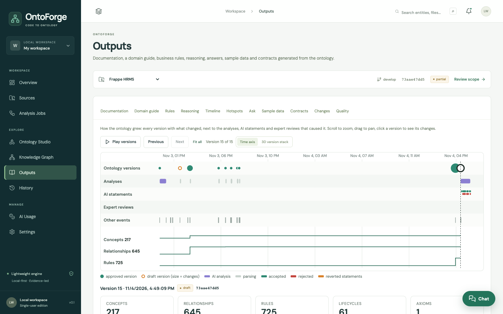
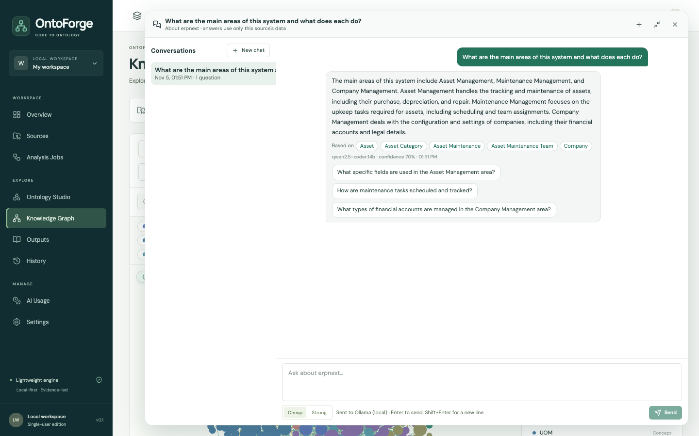
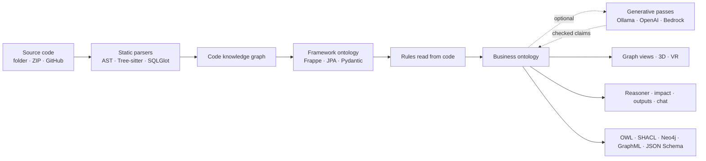

<div align="center">


# OntoForge

**Turn any codebase into a living business ontology and knowledge graph.**

Recover domain concepts, business rules, lifecycles and code mappings from source code, explore them in 2D, 3D and VR, and ask questions with grounded AI chat. Open source, local-first, works offline with Ollama.

[](https://github.com/prachh/ontoforge/actions/workflows/ci.yml)
[](LICENSE)
[](https://www.python.org/)
[](https://prachh.github.io/ontoforge/)

[Documentation](https://prachh.github.io/ontoforge/) · [Getting started](https://prachh.github.io/ontoforge/getting-started/) · [Tutorial](https://prachh.github.io/ontoforge/tutorial/) · [FAQ](https://prachh.github.io/ontoforge/faq/)



</div>

## What is OntoForge?

Every mature codebase is full of business knowledge that nobody wrote down: what an *Invoice* is, which fields it must have, who may cancel it, which states it moves through, and which code enforces all of that. OntoForge reads the code **statically** (it never runs it) and turns that knowledge into a **business ontology** linked to a **code knowledge graph**:

- **Concepts** with definitions, fields, relationships and an is-a hierarchy
- **Business rules** with the file and line that enforces them, for domain experts to confirm or dispute
- **Lifecycles, events, roles and permissions**
- **Mappings** from every concept to the classes, tables and APIs that implement it

Use it to onboard developers and analysts, document legacy systems, review business rules with domain experts, check the impact of a change before making it, or feed accurate domain context to AI agents.

## Features

- **Code to ontology without AI**: static parsers for Python, Java, JavaScript, TypeScript, Vue, SQL, OpenAPI, Maven, Gradle, Spring configuration and Markdown. Frappe DocTypes, JPA entities and Pydantic models give a full ontology with rules for free.
- **Business rules from code**: required and conditional fields, uniqueness, limits, permissions, workflows, Bean Validation, Python `raise` and `frappe.throw` checks. A rule catalogue with expert review and CSV export.
- **Generative ontology**: definitions, hierarchy, relationship meaning, axioms, lifecycles and events from a cheap and a strong model. Cost plan before running, budget caps, result caching, and an AI judge that reverts wrong claims.
- **Reasoning**: built-in OWL 2 RL reasoner (classification, contradictions, derived facts, each explained). Optional SHACL, RDFS inference and SPARQL through [Open Ontologies](https://github.com/fabio-rovai/open-ontologies).
- **Many ways to see the graph**: Sigma maps, cosmos.gl GPU graphs, deck.gl landscapes, WebVOWL-style OWL notation, ELK diagrams, a 3D code city, a two-floor code ↔ domain view, rule terrain, and **✦ Explore**, an interactive 3D graph with physics, flowing particles, fly-to camera and VR/AR.
- **Impact of a change**: everything that depends on a concept or a function, across code and domain, with the chain that explains why.
- **Outputs**: documentation, a domain guide for newcomers, JSON Schema and OpenAPI contracts, sample data, an ontology timeline and git hotspots.
- **Grounded chat**: ask about a source in plain language. Answers come only from that source's data, cite concepts, and are saved per source.
- **Open formats**: OWL/Turtle, SHACL, SKOS, GraphML, GEXF, Neo4j, Mermaid, Kineviz GraphXR and Graphistry.
- **Private by design**: runs on your machine, never executes analysed code, no telemetry, any AI provider (Ollama, OpenAI-compatible, Amazon Bedrock) or none.

## Screenshots

| | |
|---|---|
|  |  |
| **Knowledge Graph**: concepts grouped into areas | **Two floors**: concepts above the code that implements them |
|  |  |
| **Impact of a change** with explanation chains | **Business rules** read from code, reviewed by experts |
|  |  |
| **Timeline** of ontology versions | **Chat** grounded in the source's data |

Screenshots show OntoForge analysing [Frappe HRMS](https://github.com/frappe/hrms) and [ERPNext](https://github.com/frappe/erpnext).

## Quick start

Requirements: Python 3.13+, Node.js 22+ and npm.

```sh
git clone https://github.com/prachh/ontoforge.git
cd ontoforge
./scripts/start.sh
```

Open <http://127.0.0.1:8017> and click **Explore sample project**. To analyse your own code, use **Sources → Connect source** (local folder, ZIP or GitHub).

Optional local AI with [Ollama](https://ollama.com):

```sh
cp .env.example .env
# set ONTO_AI_MODEL to a model from `ollama list`, e.g. qwen2.5-coder:14b
```

Or with Docker: `docker compose up --build`. See [Getting started](https://prachh.github.io/ontoforge/getting-started/) and [Configuration](https://prachh.github.io/ontoforge/configuration/).

## How it works



Every AI statement is a **claim** with its model, confidence and evidence, validated before it is applied (names must exist, cited code must have been seen, no hierarchy cycles, valid rule operators) and sampled by an AI judge. Read more in [Generative ontology](docs/concepts/generative-ontology.md) and [Architecture](docs/reference/architecture.md).

## Documentation

| Guide | Concepts | Reference |
|---|---|---|
| [Getting started](docs/getting-started.md) | [Ontology vs knowledge graph](docs/concepts/ontology-vs-knowledge-graph.md) | [Architecture](docs/reference/architecture.md) |
| [Tutorial](docs/tutorial.md) | [Generative ontology](docs/concepts/generative-ontology.md) | [Ontology engines](docs/reference/ontology-engines.md) |
| [Configuration](docs/configuration.md) | [Canonical ontology model](docs/concepts/ontology-model.md) | [Open Ontologies](docs/reference/open-ontologies.md) |
| [Knowledge Graph](docs/user-guide/knowledge-graph.md) | [Code discovery](docs/concepts/code-discovery.md) | [Scale and limitations](docs/reference/scale-and-limitations.md) |
| [Outputs](docs/user-guide/outputs.md) · [Chat](docs/user-guide/chat.md) | [Supported languages and formats](docs/concepts/supported-formats.md) | [FAQ](docs/faq.md) |

## Development

```sh
.venv/bin/python -m pytest -q                                   # backend tests
npm run build --prefix web                                      # type-check and build the web app
.venv/bin/python -m uvicorn backend.main:app --port 8017 --reload
npm run dev --prefix web                                        # Vite dev server, proxies /api
```

Browser tests: start the server against a throwaway data folder (`ONTO_DATA=/tmp/ontoforge-test`), then `cd web && npx playwright test`. The API reference is served at `/docs`.

## Status

OntoForge is a young project and a local, single-user application: there is no authentication, so keep it bound to localhost. It has been used on Frappe HRMS, ERPNext, Spring PetClinic, InvenTree and OBP-API. Known gaps are listed in [Scale and limitations](docs/reference/scale-and-limitations.md).

## Contributing

Contributions are welcome: new parsers and framework readers, graph views, docs and bug reports. Read [CONTRIBUTING.md](CONTRIBUTING.md) and the [Code of Conduct](CODE_OF_CONDUCT.md). Report security issues privately as described in [SECURITY.md](SECURITY.md).

## Acknowledgements

Built on [FastAPI](https://fastapi.tiangolo.com), [Pydantic](https://docs.pydantic.dev), [Tree-sitter](https://tree-sitter.github.io), [SQLGlot](https://github.com/tobymao/sqlglot), [React](https://react.dev), [Sigma.js](https://www.sigmajs.org), [graphology](https://graphology.github.io), [React Flow](https://reactflow.dev), [ELK](https://eclipse.dev/elk/), [cosmos.gl](https://github.com/cosmograph-org/cosmos), [deck.gl](https://deck.gl), [three.js](https://threejs.org), [React Three Fiber](https://r3f.docs.pmnd.rs), [r3f-forcegraph](https://github.com/vasturiano/r3f-forcegraph) and [Open Ontologies](https://github.com/fabio-rovai/open-ontologies).

## License

[MIT](LICENSE) © Pravesh Chhabra and OntoForge contributors.
