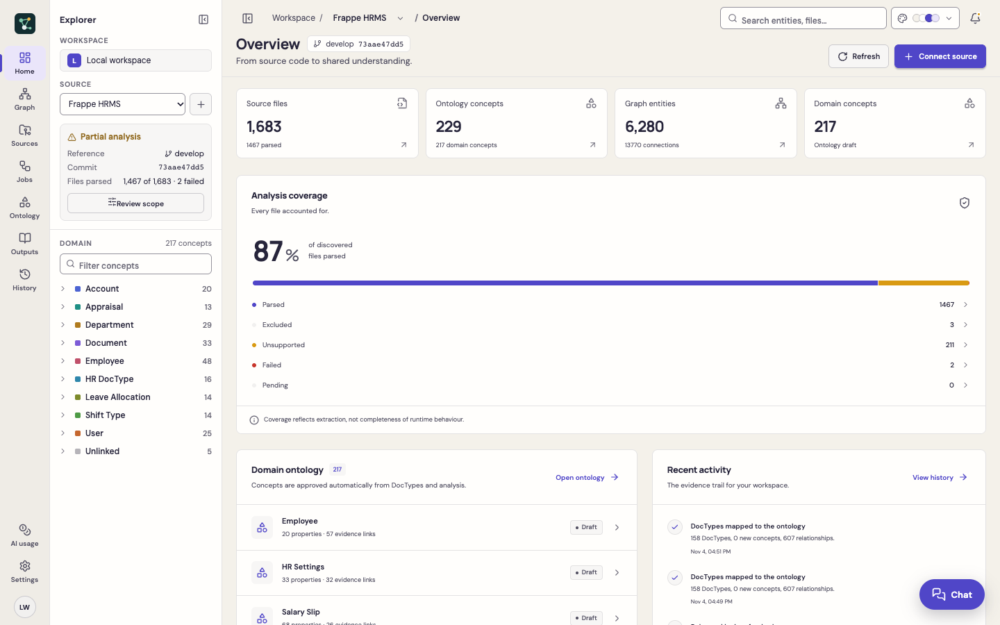

# Getting started

## Requirements

- **Python 3.13+**
- **Node.js 22+** and npm
- Optional: **[Ollama](https://ollama.com)** for local AI (no API key, no data leaves your machine), or an OpenAI-compatible or Amazon Bedrock account
- A browser with WebGL for the 3D views (any current Chrome, Edge, Firefox or Safari)

## Install and start

```sh
git clone https://github.com/prachh/ontoforge.git
cd ontoforge
./scripts/start.sh
```

Open **<http://127.0.0.1:8017>**.

The first start creates a Python virtual environment (`.venv`), installs the pinned dependencies (`requirements.lock.txt`, `web/package-lock.json`), builds the web app and serves it with FastAPI. Later starts reuse them. Set `PORT` to use another port.

### Development mode

Run the API with auto-reload and the Vite dev server in two terminals:

```sh
.venv/bin/python -m uvicorn backend.main:app --port 8017 --reload
npm run dev --prefix web
```

Vite proxies `/api` to port 8017. The interactive API reference is at <http://127.0.0.1:8017/docs>.

### Docker

```sh
docker compose up --build
```

The app is published on `127.0.0.1:8017`, data persists in the `ontoforge-data` volume, and `./sample` is mounted read-only as `/sources`. Change that mount to analyse your own folder. Inside Docker, Ollama on the host is reached at `http://host.docker.internal:11434` (`ONTO_DOCKER_AI_BASE_URL`); the host Ollama must accept connections from containers.

## Your first analysis

1. On **Overview**, click **Explore sample project**. The bundled Meridian sample is parsed (Python, TypeScript, SQL, OpenAPI and Markdown).
2. Open **Graph** in the navigation rail to see the domain ontology and the code graph (switch with **Domain / Code**). Try the **View** selector: 2D map, cosmos.gl, deck.gl, 3D views and **✦ Explore**.
3. Open **Outputs** for the rule catalogue, documentation, reasoning results, timeline and more.

Then analyse your own code with **Connect source** (on Home and Sources, or **+** next to the source selector in the explorer panel):

| Source | How |
|---|---|
| Local folder | Choose a folder inside an allowed root. By default only the OntoForge folder itself is allowed; set `ONTO_LOCAL_ROOTS` in `.env` to the folders holding your code (for example `ONTO_LOCAL_ROOTS=/Users/me/code`). The folder must be on the machine running the backend. |
| ZIP upload | Upload an archive from any device. |
| GitHub | Paste `https://github.com/owner/repo`, choose a branch, tag or commit. Private repositories need a fine-grained token. See [GitHub sources](user-guide/github-sources.md). |

In the scope dialog choose:

- **Parsing only**: no AI calls; frameworks such as Frappe and JPA still give a full ontology with rules.
- **Live AI**: also asks your AI provider to discover concepts the code does not declare. You must confirm that code excerpts may be sent.

After analysis, **Generate with AI** (in the header of the Graph and Ontology pages) adds definitions, hierarchy, relationship meaning, rules, lifecycles and events, with a cost plan before it runs. See [Generative ontology](concepts/generative-ontology.md).

## Finding your way around



- The **navigation rail** on the left has Home, Graph, Sources, Jobs, Ontology, Outputs and History, with AI usage and Settings at the bottom.
- The **explorer panel** next to it shows the selected source, its analysis status and the domain tree; hide it with the button at the top left to give the page more room.
- Switch sources from the explorer panel or from the source name in the **breadcrumb**.
- Choose a **colour theme** with the palette button in the header; six themes are available and Sand & Indigo is the default.

## Next steps

- [Configuration](configuration.md): AI providers, limits and optional integrations
- [Tutorial](tutorial.md): a guided tour with the sample project
- [Knowledge Graph](user-guide/knowledge-graph.md): every graph view, 3D and VR
