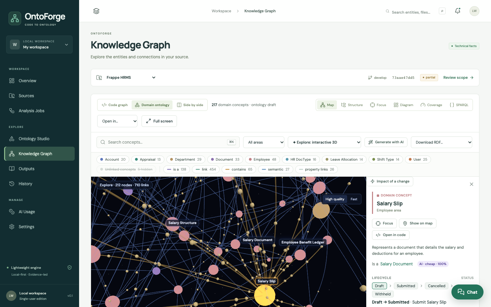

# OntoForge

**Turn any codebase into a living business ontology.**

OntoForge reads your source code and recovers the business knowledge buried in it: the domain concepts, their fields and relationships, the business rules the code enforces, document lifecycles and events, and exactly which code implements each one. You explore the result as an interactive knowledge graph in 2D, 3D and VR, export it as OWL/RDF, Neo4j or JSON Schema, and ask questions about it in plain language.

It is open source, runs on your machine, never executes the code it reads, and works fully offline with a local model through [Ollama](https://ollama.com).



## Why OntoForge?

- **Onboard faster.** New developers and analysts get a map of the business domain, a glossary and a domain guide instead of reading thousands of files.
- **Know your rules.** Thousands of business rules are extracted from code with the file and line they come from, so domain experts can confirm or dispute them.
- **Change safely.** *Impact of a change* shows which concepts, code, tests, APIs and rules depend on what you are about to touch.
- **Keep knowledge current.** Re-analyse after every change; versions, a timeline and change logs show how the business model evolves.
- **Stay in control.** Local-first, no telemetry, pluggable AI (local or cloud), and every AI statement is checked and traceable.

## Features

| | |
|---|---|
| **Code to ontology** | Static parsers for Python, Java, JavaScript/TypeScript, Vue, SQL, OpenAPI, Maven/Gradle, Spring config and Markdown; Frappe DocTypes and JPA entities give a full ontology without AI. |
| **Business rules from code** | Field constraints, permissions, workflows, Bean Validation, Python `raise` checks, Pydantic models, plus an AI rules pass. |
| **Generative ontology** | Definitions, hierarchy, relationship meaning, axioms, lifecycles and events from cheap and strong models, with cost plans, budget caps, caching and an AI judge. |
| **Reasoning** | A built-in OWL 2 RL reasoner that classifies, finds contradictions and explains every result; optional SHACL, RDFS and SPARQL. |
| **Graph views** | Sigma, cosmos.gl (GPU), deck.gl, WebVOWL-style OWL notation, ELK diagrams, 3D code city, two-floor code↔domain view, terrain, and an interactive 3D Explore mode with VR/AR. |
| **Impact analysis** | Reverse dependencies across code and concepts with an explanation chain. |
| **Outputs** | Documentation, domain guide, rule catalogue, contracts (JSON Schema, OpenAPI), sample data, timeline and git hotspots. |
| **Grounded chat** | Ask about a source; answers cite concepts and are built only from that source's data. |
| **Exports** | OWL/Turtle, SHACL, SKOS, GraphML, GEXF, Neo4j, Mermaid, Kineviz GraphXR, Graphistry. |

## Get started

```sh
git clone https://github.com/prachh/ontoforge.git
cd ontoforge
./scripts/start.sh   # then open http://127.0.0.1:8017
```

Read [Getting started](getting-started.md), take the [ten-minute tutorial](tutorial.md), or browse the [user guide](user-guide/knowledge-graph.md).
