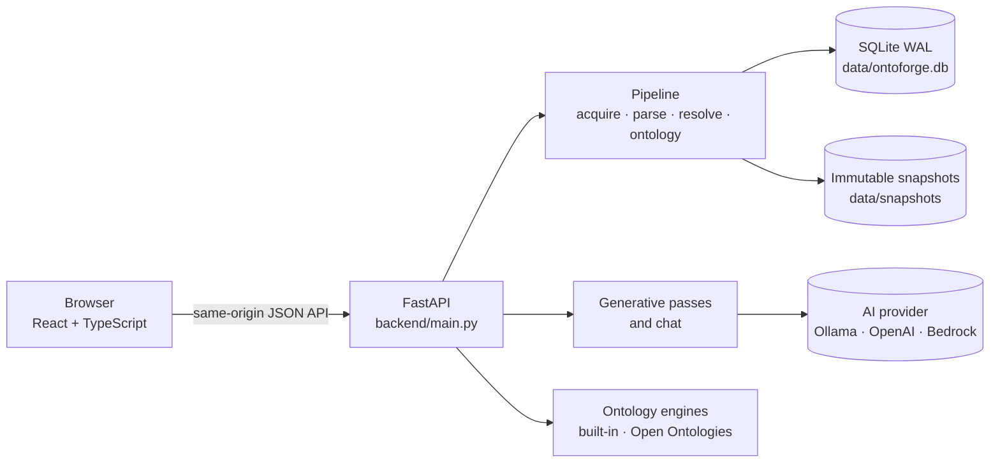

# Architecture

OntoForge is one Python process serving a React single-page app and a JSON API, with SQLite for storage. There is no separate database server, queue or graph database.

## Backend (`backend/`)

| Module | Responsibility |
|---|---|
| `main.py` | FastAPI routes, background job pool, serving the built web app. Interactive API docs at `/docs`. |
| `store.py` | SQLite access: `records` (typed JSON documents), `files`, `entities`, `edges`, `cache`, `logs`. |
| `acquisition.py` | Local folders, ZIP uploads and GitHub archives pinned to one commit. |
| `parsers.py` | Static parsers (Python AST, Tree-sitter, SQLGlot, YAML/JSON, XML, Markdown). Source code is never imported or executed. |
| `pipeline.py` | Inventory, parsing with checkpoints, reference resolution, technical and domain ontology, AI concept discovery. |
| `logic.py` | Rules read from code (Frappe, JPA, Python checks, Pydantic and dataclass fields), axioms and the OWL 2 RL reasoner. |
| `generative.py` | The generative passes (definitions, hierarchy, relationships, logic, rules, lifecycles, events), claim checking and the AI judge. |
| `knowledge.py` | The domain guide (Domain Expertise Knowledge Set). |
| `chat.py` | Grounded chat over one source; conversations stored per source. |
| `impact.py` | Impact of a change across concepts and code. |
| `history.py` | Ontology timeline and git hotspots. |
| `semantic.py` | RDF/OWL, SHACL and SKOS export; SPARQL helpers. |
| `engine.py`, `external.py` | Built-in ontology engine and the optional Open Ontologies adapter. |
| `graph_export.py` | GraphML, GEXF, Neo4j, Mermaid, GraphXR and Graphistry exports. |
| `ai.py`, `usage.py` | Provider clients with JSON-schema output, token metering and cost. |
| `models.py` | Pydantic models for the canonical ontology. |

## Frontend (`web/src/`)

| File | Responsibility |
|---|---|
| `main.tsx` | App shell, pages (Overview, Sources, Analysis Jobs, Ontology Studio, Knowledge Graph, Outputs, History, AI Usage, Settings), Outputs tabs and the chat widget. |
| `explorer.tsx` | Knowledge Graph explorer: Map (Sigma + ForceAtlas2, Louvain areas), Structure, Focus, Diagram (React Flow with dagre or ELK), Coverage, SPARQL, impact panel. |
| `engines.tsx` | cosmos.gl GPU view and the WebVOWL-style OWL notation view. |
| `deckview.tsx` | deck.gl 2.5D landscape. |
| `city3d.tsx` | Shared three.js scene (quality switch, post-processing, WebXR), 3D code city and two-floor view. |
| `views3d.tsx` | 3D force graph, rule/code terrain, version stack. |
| `explore3d.tsx` | Explore: the interactive 3D graph (r3f-forcegraph). |
| `webgl.ts` | WebGL capability check and context-loss recovery. |

Heavy graph engines are loaded only when chosen, so the default views stay light.

## Persistence

`records` holds typed application documents scoped by source and snapshot: sources, jobs, snapshots, proposals, mappings, ontology versions, claims, reviews, conversations, engine runs and events. `files`, `entities` and `edges` are indexed tables for manifests, coverage and graph traversal. `cache` keys parser output by content hash, path and parser version, so unchanged files are not parsed again. `data/snapshots/<id>/files` holds the captured bytes of each snapshot.

SQLite suits a local single-user tool: no server to run, and bounded neighbourhood queries are fast. It has no sharding, distributed scheduling or multi-tenant access control.

## Pipeline

Acquire source → inventory, hash and exclude → parse files → conservative reference resolution → code graph → technical concepts → framework concepts (Frappe DocTypes, JPA entities) and rules read from code → optional AI concept discovery → automatic acceptance and duplicate merging → validated ontology version. Each parsed file and each AI batch commits a checkpoint, so jobs resume after a restart. The generative passes run later, on demand, from **Generate with AI**.

## Boundaries

- Analysis never imports or executes source code, installs its dependencies or runs its hooks.
- Parser and model outputs are untrusted. Models get an explicit data boundary, cannot emit executable code, and every claim is validated before it is applied.
- The optional external engine runs only a pinned, digest-checked binary with fixed arguments, an isolated data directory, a credential-free environment and bounded time and output.
- Ad-hoc SPARQL is limited to read-only query forms; updates and federated `SERVICE` calls are refused.
- Non-loopback web origins are rejected. There is no authentication, so keep the server bound to loopback.
