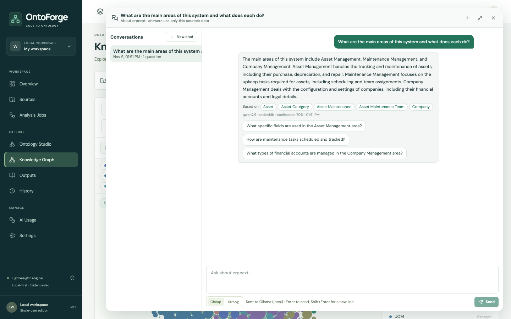

# Chat

The **Chat** button (bottom right, on every page once a source has an ontology) answers questions about the selected source in plain language.

## Grounded in your source

Each answer is built only from that source's data:

- a summary: counts, rules per concept, lifecycles, all concept names
- the concepts matching the question and the recent conversation, with their fields, links, rules, lifecycles and events
- other matching business rules
- matching code names and file paths (**no source code is sent**)
- domain guide excerpts and git hotspots, when available

The assistant is told to answer only from this data and to say when the data does not contain the answer. It cites the concepts it used (click one to open it in the Knowledge Graph) and suggests follow-up questions.

## Conversations

Conversations are saved under the source, so you can reopen them later from the history list, rename or delete them. **Expand** opens a large view with the history alongside. Choose the **Cheap** or **Strong** model per message; each answer is one metered model call, visible in **AI Usage**.

## Tips

- If an answer says the data is missing, it usually is: run **Generate with AI** or re-analyse the source to add rules, definitions or lifecycles.
- Questions about who may do something use permission rules; Frappe DocTypes provide them from their permissions table.
