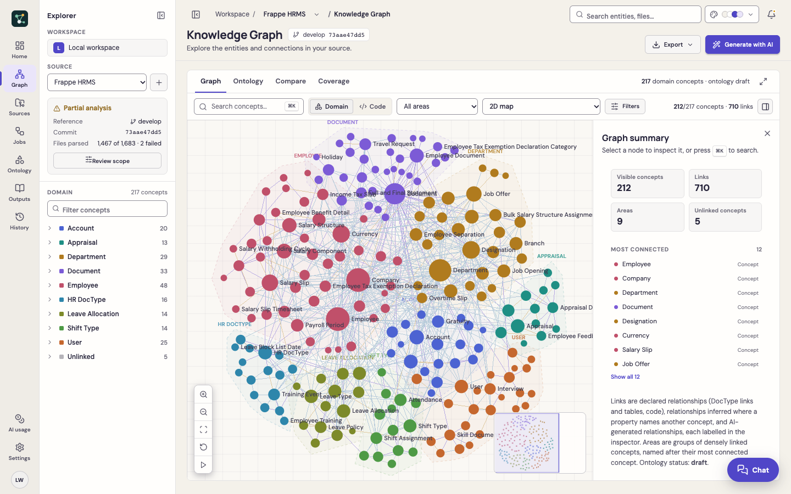
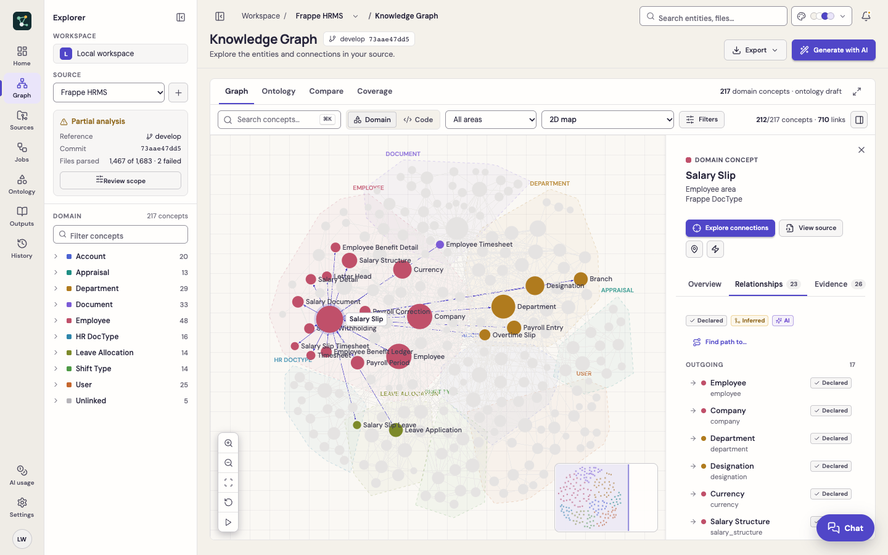
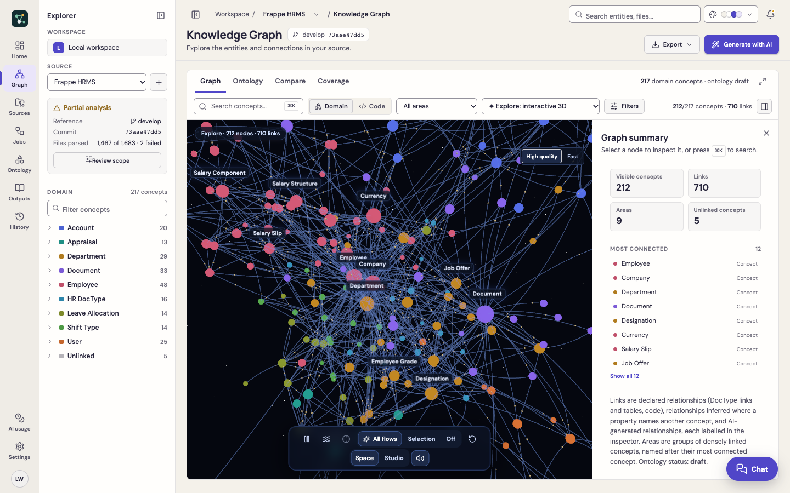
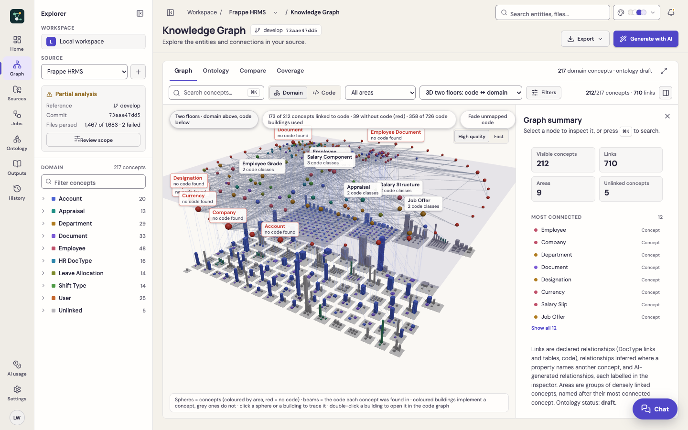
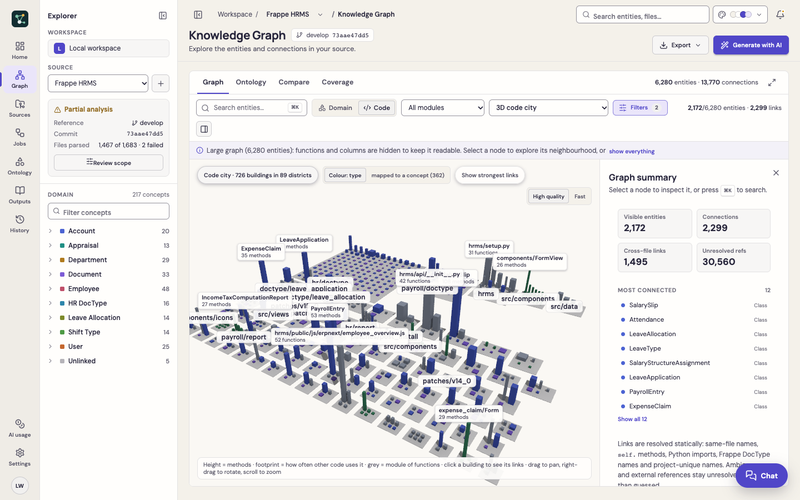
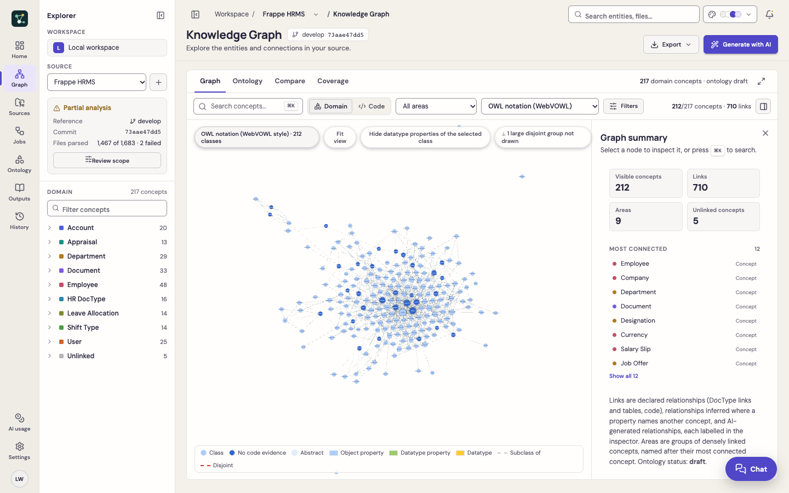
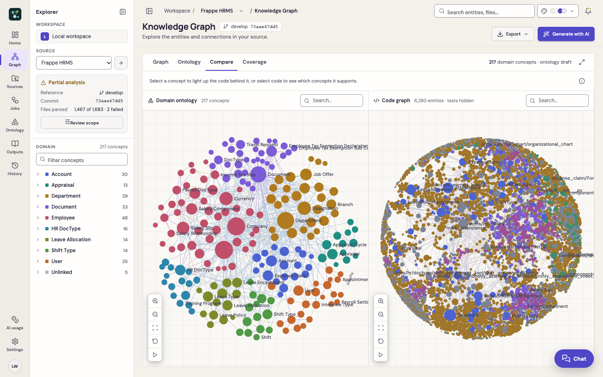
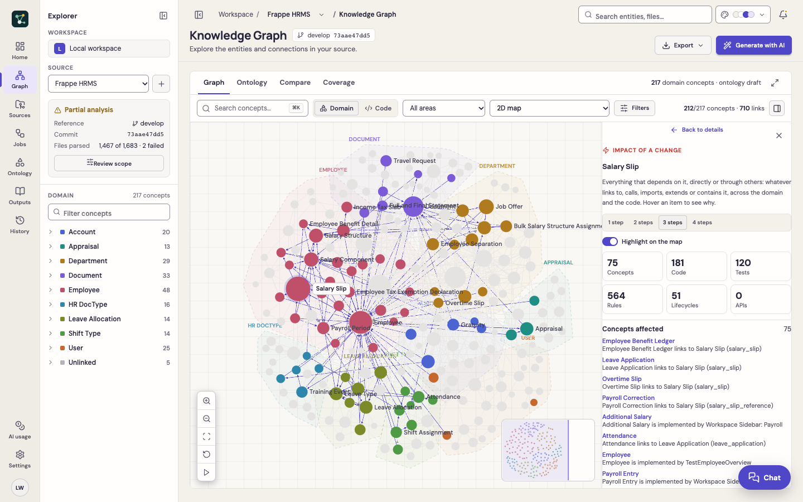
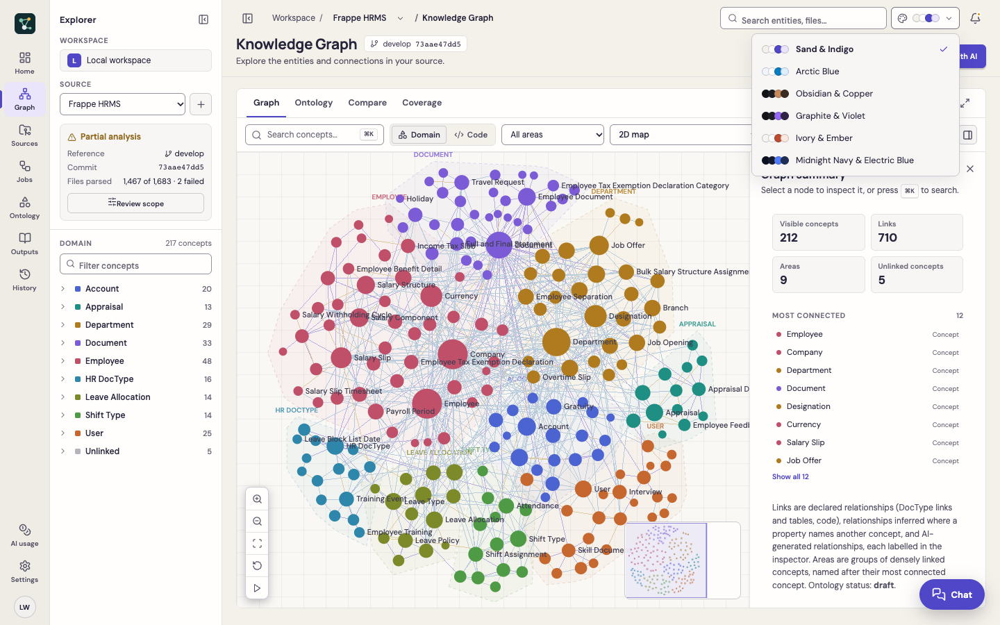

# Knowledge Graph

The Knowledge Graph page shows two layers of the same source:

- **Domain**: business concepts, their fields, relationships, rules and lifecycles (the ontology).
- **Code**: files, classes, functions, APIs, tables and tests, with their calls, imports and references.

Switch between them with **Domain / Code** in the toolbar. The concept→code mappings link the two layers, so a selection in one can be followed into the other.

## Page layout

| Area | What it holds |
|---|---|
| **Navigation rail** (far left) | Home, Graph, Sources, Jobs, Ontology, Outputs, History; AI usage and Settings at the bottom. Hover for the full name. |
| **Explorer panel** | Workspace, source selector, analysis status (complete, partial or running, with reference, commit and parsed files), **Review scope**, and a searchable **domain tree** of areas and their concepts. Click a concept to select and centre it; click an area to show only that area. Collapse the panel with the button at the top left of the header. |
| **Header** | Breadcrumb with a **source switcher** (also available with the explorer collapsed), page title, branch and commit, **Export**, **Generate with AI**, global search, the **colour theme** picker and workspace activity. |
| **Tabs** | **Graph**, **Ontology**, **Compare** and **Coverage**, with compact counts and **Full screen** on the right (Esc leaves full screen). |
| **Toolbar** | Search (⌘K / Ctrl+K), Domain / Code, area or module, view, **Filters** (with the number of active filters) and the visible counts. The last button shows or hides the inspector. |
| **Inspector** (right) | Details of the selection; resizable by dragging its left edge. |

At narrower widths the explorer panel opens as an overlay and the inspector as a drawer, so the graph keeps the space.

## Tabs

| Tab | Views |
|---|---|
| **Graph** | The 2D map, *Focus: neighbourhood*, and every 2.5D/3D view from the **View** selector |
| **Ontology** | **Structure** (hierarchy and folders), **Diagram** (UML-style class diagram, *dagre* or *Layered (ELK)* layout) and **SPARQL** on the domain layer; **Structure** and the paginated **Table** on the code layer |
| **Compare** | Domain and code maps side by side. Selecting on one side lights up its counterpart on the other and opens the inspector; the ⓘ button explains the view |
| **Coverage** | How much of the code is explained by concepts, plus model-check findings |

## The 2D map

- Nodes are coloured by **area** (groups of densely linked concepts, named after their most connected concept) on the domain layer, and by **type** or **module** on the code layer. Areas are outlined with subtle boundaries.
- Hover or select a node: its neighbourhood is highlighted with directional connectors in the theme's selection colour and everything else is dimmed. Labels on connectors appear only for small neighbourhoods, to avoid clutter.
- **Canvas controls** (bottom left): zoom in, zoom out, fit, reset and re-run layout. The keyboard works too when the canvas has focus: arrow keys pan, `+` and `−` zoom, `0` fits.
- The **minimap** (bottom right) shows the whole layout with the visible window; click or drag in it to move there.
- **Large graphs**: a code graph with more than 2,500 entities opens with functions and columns hidden (a note says so, with **show everything**). Select a node and use **Explore connections** to work through its neighbourhood.

## Filters

**Filters** opens a panel with entity types (code layer), relationship kinds (with counts), unlinked concepts or test code, and on the code layer the domain overlay, *only mapped to concepts* and colour by type or module. Filters update the map, the counts and the inspector together, and are remembered per layer. **Reset filters** clears them.

## Inspector

With nothing selected the inspector shows a **graph summary**: visible concepts or entities, links, areas, unresolved references and the most connected nodes.

Select a node to see:

- **Overview**: description (with its origin), is-a parent, properties, lifecycle, rules, events, roles, quality findings and aliases for a concept; type, module and mapped concepts for code.
- **Relationships**: outgoing and incoming rows, each with direction, the linked node, what links them and where the link came from: **Declared** (code or framework metadata), **Inferred** (a property named after another concept) or **AI** (with the model's confidence when it reported one). Click a row to go to that node; **Find path to…** finds a path to another node.
- **Evidence**: the code that supports a concept, each with **View source** (excerpt, location, provenance, GitHub link) and a jump to the code graph, plus the AI statements about it.

Actions: **Explore connections** (focus on the neighbourhood, 1–3 steps), **View source**, **Show on map** and **Impact of a change**.

## Views

The **View** selector changes how the graph is drawn, not the data. Your choice is remembered, and each view loads only when chosen.

| View | Layers | Best for |
|---|---|---|
| **2D map** | both | Everyday exploration; fast for thousands of nodes |
| **Focus: neighbourhood** | both | One node and its neighbours, step by step, with a trail to go back |
| **GPU, large graphs (cosmos.gl)** | both | Very large graphs; the force layout runs on the GPU |
| **OWL notation (WebVOWL)** | domain | Ontologists: classes, object and datatype properties, subclass and disjoint links |
| **✦ Explore: interactive 3D** | both | Playing with the graph: living physics, drag and pin, flowing particles |
| **2.5D landscape (deck.gl)** | both | Columns whose height is rules, links, properties, members or git changes |
| **3D code city** | code | Folders as districts, classes as buildings (height = methods, footprint = usage) |
| **3D two floors: code ↔ domain** | domain | Concepts floating above the code city with beams to the code that implements them |
| **3D force graph** | both | The graph laid out in three dimensions |
| **3D rule / code terrain** | both | A landscape whose height is the density of rules, links or git changes |

### ✦ Explore

- The graph assembles from the centre, then keeps "breathing" (physics runs gently; large graphs settle).
- **Drag** a node to move it, drop to pin it; double-click to unpin, or **Unpin all**.
- **Click** a node to fly the camera to it. A breadcrumb trail records where you have been (Esc steps back).
- Particles flow along links in the dependency direction: all links, the selection only, or off.
- **Pause/Resume** (Space), **Shake**, **Focus** (F, 1–3 steps around the selection), **Reset** (R).
- A minimap shows where you are; click it to fly there. Idle for a few seconds and the camera orbits.
- Explore has its own scene themes: **Space** (dark, glow, stars) and **Studio** (light). Subtle synthesised sounds have a mute button.
- With *reduced motion* set in your OS, the intro, orbit, flights and particles are turned off.

### 3D views, quality and VR

Every 3D view has a **High quality / Fast** switch (high adds soft shadows, ambient occlusion and glow). On a device with WebXR, **Enter VR** and **Enter AR** place the scene in front of you at table scale. Add `?xr-emulate` to the URL to test the buttons without a headset.

## Compare

Both maps use the full width until you select something; then the inspector opens on the right. Selecting a concept lights up the code behind it; selecting code shows which concepts it supports.

## Impact of a change

Select any concept or code entity and choose **Impact of a change** (the lightning button in the inspector). OntoForge follows dependencies backwards (who calls, imports, extends, uses or links to it) across both layers and lists:

- affected concepts and code, each with the chain that explains why
- tests to run, APIs, business rules to re-check and lifecycles involved

Choose 1–4 steps. The affected nodes are highlighted on the map; Explore and the 3D views animate pulses along the chain.

## Export

**Export** in the header downloads the graph; a message confirms the file name, and failures are reported instead of opening a broken page.

| Group | Formats |
|---|---|
| **Ontology (RDF/OWL)** | OWL ontology (Turtle), ontology + records, everything with the code graph, SHACL shapes (for Protégé and other RDF tools) |
| **Graph files** | GraphML (Gephi, yEd, Cytoscape, NetworkX), GEXF (Gephi, Gephi Lite), Neo4j (CSV with an `import.cypher` for `LOAD CSV`, plus `neo4j-admin` files), Mermaid class diagram of the 60 most connected concepts |
| **External tools** | Kineviz GraphXR (domain + code, domain or code), and **Graphistry…**, which uploads only after you confirm (optional, see [Configuration](../configuration.md#graphistry-gpu-graph-hosting)) |

## Colour themes

The palette button in the header switches between six themes: **Sand & Indigo** (default), **Arctic Blue**, **Obsidian & Copper**, **Graphite & Violet**, **Ivory & Ember** and **Midnight Navy & Electric Blue**. Every page, dialog, chart and graph view follows the theme, and switching keeps your selection, filters, camera and unsaved edits. The choice is remembered in your browser.

## Generate with AI

**Generate with AI** (header, on the Knowledge Graph and Ontology pages) runs the generative passes (definitions, hierarchy, relationships, logic, rules, lifecycles, events) with a cost plan and budget cap. See [Generative ontology](../concepts/generative-ontology.md).
