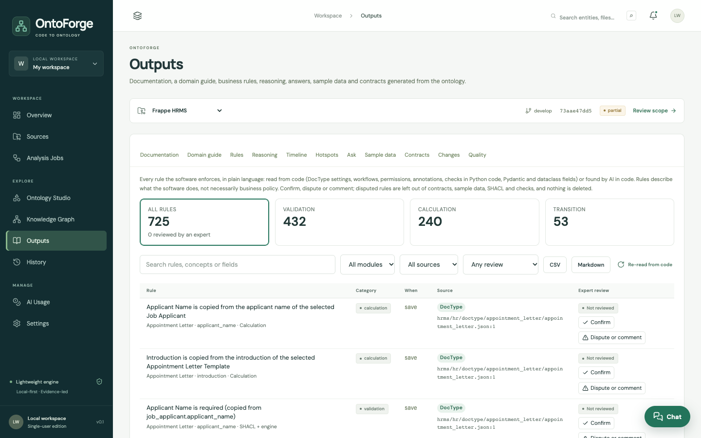
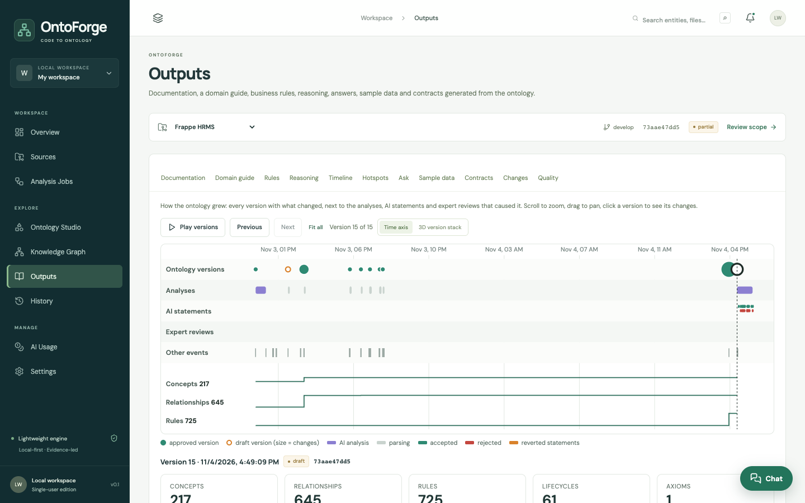
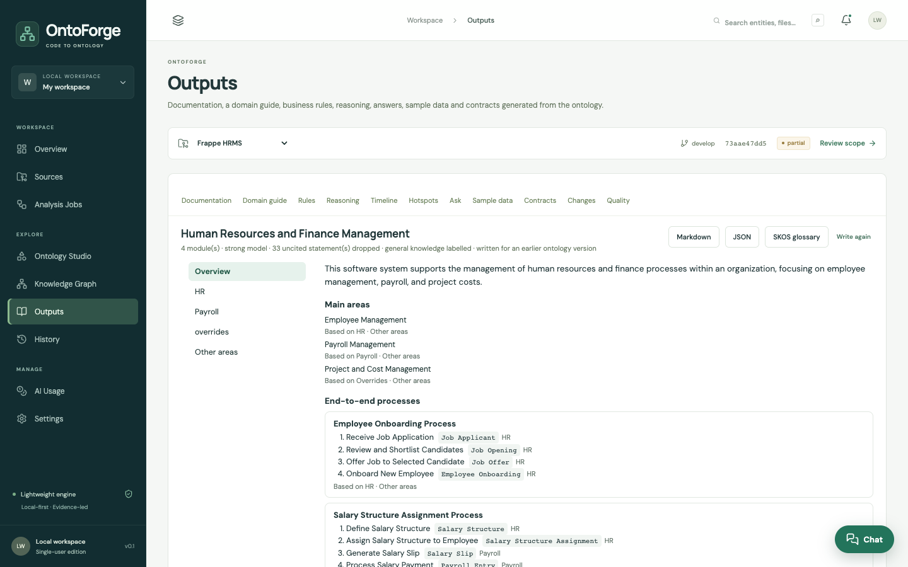

# Outputs

**Outputs** turns the ontology into things people and tools can use. Everything except **Ask** and the **Domain guide** is computed without a model.

| Tab | What you get |
|---|---|
| **Documentation** | A data dictionary by module: concepts, fields, links, rules and lifecycles. Markdown download. |
| **Domain guide** | A Domain Expertise Knowledge Set for newcomers: overview, areas, processes, glossary, roles, measures, edge cases, FAQ and a learning path. Markdown, JSON and SKOS downloads. |
| **Rules** | The business rule catalogue with filters, Markdown and CSV downloads, and expert review. |
| **Reasoning** | Axioms, contradictions, the implied hierarchy and derived facts from the OWL 2 RL reasoner, each with an explanation. |
| **Timeline** | Every ontology version on a time axis with the analyses, AI statements, reviews and events around it. |
| **Hotspots** | Files ranked by risk from git history. |
| **Ask** | Grounded Q&A over the ontology, with cited concepts. |
| **Sample data** | Deterministic records that satisfy field types, options and executable rules, then checked against them. |
| **Contracts** | JSON Schema and OpenAPI 3.1 components (types, enums, references, inheritance, patterns, lengths). |
| **Changes** | What changed in the business model compared with the previous version. |
| **Quality** | The AI judge's score, verdicts and reverted claims, and every AI statement with its status. |

## Rules

Rules are read from code at no model cost (DocType field settings, permissions, workflows, JPA Bean Validation, Python `raise` and `frappe.throw` checks, Pydantic and dataclass fields) and can be extended by the AI rules pass. Each has a category, trigger, severity and the file and line it came from.

Domain experts can **Confirm**, **Dispute** or mark **Needs clarification**, with a comment. Reviews never delete anything; a disputed rule is left out of contracts, sample data, SHACL and the reasoner until it is reset. **Re-read from code** rebuilds rules from the current snapshot without a model.

## Timeline

Zoom, pan and **play** through versions to see what each one added, removed or changed. **3D version stack** shows every version as a layer (added concepts in green, removed in red); click a concept to trace it through the versions.

## Hotspots

**Read git history** ranks files by risk = commits × code size × business rules, with authors and last change. For GitHub sources only commit metadata is fetched (a blob-less shallow clone, no file contents); local folders must be inside a git repository. The 3D code city, terrain and deck.gl landscape can then colour or size code by commits.

## Domain guide

Generated from the ontology only (no source code is sent): one model call per module plus an overview, with the cost shown before you start and results cached. Every statement about the system must cite concepts or rules, or it is dropped; statements from general industry knowledge are labelled.
